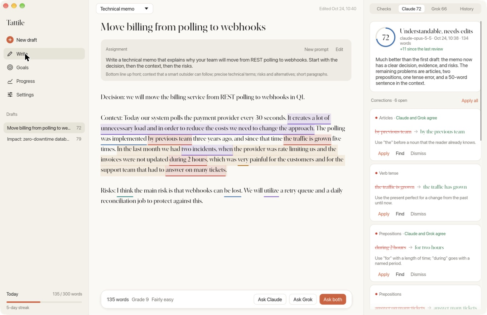

# Tattile

Tattile is a native macOS app to practice writing in English. It helps you set a goal, write a draft,
get corrections, and revise. It connects to Claude and Grok for a feedback loop.

Tattile is for people who write English as a second language and write at work: strategy documents,
technical memos, promotion documents, status updates, and stories.

> **Status:** proof of concept (v0.1.0). It works end to end, but it is not polished or signed.



## What it does

- **Goals.** Set a daily word goal, a weekly number of drafts, a target score, a main document type,
  and focus areas (for example, articles or prepositions). The app counts your streak.
- **Practice assignments.** Each document type has realistic assignments for an engineering manager.
  You can write your own topic, or practice the exercise that the last review suggests.
- **Instant offline checks.** While you type, the editor marks long sentences, passive voice, wordy
  phrases, complex words and jargon, filler words, hedges, and repeated words. It also shows the
  reading ease and the grade level.
- **AI review from Claude and Grok.** One click sends the draft for a review. You get:
  - a score from 0 to 100, and the change since the last review,
  - exact corrections (original → suggestion) with a short rule for each one,
  - what works, what to improve, and your recurring habits,
  - a polished version to compare with,
  - one targeted exercise for your weakest area.
- **The feedback loop.** Apply corrections one by one or all at once (with Undo), revise, and ask
  again. The History tab shows each round and the score trend. "Ask both" gets two opinions. The app
  marks corrections that both Claude and Grok agree on.
- **Mistake journal.** The Progress page shows your most common mistake types and habits over time.
  The app sends your top habits to the AI with each review, so the coach checks them first.

## Requirements

- macOS 12 or later.
- Rust 1.85 or later (edition 2024). Install it with [rustup](https://rustup.rs).
- Xcode command line tools (for the linker).
- An Anthropic API key, an xAI API key, or both. The offline checks work without a key.

## Build and run

Run the app in development:

```bash
cargo run --release
```

Build a real `Tattile.app` bundle in `dist/`:

```bash
./scripts/bundle.sh
```

Open the app with sample drafts and reviews. This uses a temporary folder, so your real data stays
clean:

```bash
./scripts/demo.sh
```

Run the tests:

```bash
cargo test
```

In a debug build, set `TATTILE_DEBUG_LAYOUT=1` to mark widgets that are wider than their space.

## Connect Claude and Grok

1. Open **Settings** in the app.
2. Paste your API key, then click **Save to Keychain**. The key goes into the macOS Keychain, not into
   a file.
3. Click **Test & load models**. This checks the key and lists the models that your account can use.

You can also set the environment variables `ANTHROPIC_API_KEY` and `XAI_API_KEY`. The Keychain wins
if both exist.

| Provider | API | Default model | Notes |
|---|---|---|---|
| Claude | Anthropic Messages API, version `2026-10-21` | `claude-opus-5-5` | Structured JSON output (`output_config.format`), adjustable effort, server-side refusal fallback. |
| Grok | xAI chat completions (OpenAI-compatible) | `grok-4.5` | Structured JSON output (`response_format`). |

To use a different model, type its ID in **Settings → Model**, or pick one from the loaded list.

## Your data

- Drafts, reviews, and goals are in one JSON file:
  `~/Library/Application Support/com.tattile.Tattile/data.json`.
- Set `TATTILE_DATA_DIR` to keep the data in a different folder.
- The app sends your text only to the AI provider that you ask, and only when you click **Ask**.

## Architecture

The app is one Rust binary. It uses [egui/eframe](https://github.com/emilk/egui) 0.37 for the UI.
egui is immediate-mode: each frame draws the UI again from the app state. The window has no title
bar: the traffic lights sit in the sidebar, and the top strip of each column moves the window.

| File | Job |
|---|---|
| `src/main.rs` | Opens the window. |
| `src/app.rs` | App state, actions (apply, undo, restore), the AI event loop, and autosave. |
| `src/model.rs` | Data on disk: goals, sessions, review rounds, settings, streak, and statistics. |
| `src/analysis.rs` | The offline checks: words, sentences, readability, passive voice, word lists. |
| `src/prompts.rs` | Practice assignments and the instructions for the AI coach. |
| `src/ai.rs` | HTTP clients for Claude and Grok, the JSON schema, and response parsing. |
| `src/secrets.rs` | API keys in the macOS Keychain, with environment variables as a fallback. At startup the app only checks that a key exists. It reads the key when you ask for a review. |
| `src/storage.rs` | Atomic save and load of the JSON file. |
| `src/theme.rs` | Light and dark palettes in the style of the Claude desktop app, macOS fonts (SF Pro, New York), and widget styles. |
| `src/ui/` | The screens: sidebar, write (editor), feedback panel, goals, progress, settings. |

How a review works:

1. You click **Ask Claude**. The app builds a prompt with the document type, the assignment, your
   focus areas, your recurring habits, and the previous score.
2. A background thread sends the request. The UI stays responsive.
3. The thread sends the result back through a channel. `App::logic` stores it, even when the window
   is hidden.
4. The editor marks each open correction in the text. **Apply** replaces the exact `original` span.

## Limits of this proof of concept

- The app is not signed with a Developer ID, so it runs only on the Mac that built it (ad-hoc
  signature). After a rebuild, macOS asks again for Keychain access the first time you ask for a
  review. Click "Always Allow".
- The offline checks use word lists and simple rules. They do not check grammar. The AI review
  does that.
- A request waits for the full answer (no streaming). A review takes 20 to 90 seconds.
- **Apply** replaces the first match of the original text. If the same phrase occurs twice, it can
  change the wrong one.
- There is no app icon yet.

## Next steps

- Stream the review, so the corrections appear one by one.
- Add a "rewrite this sentence" action and a side-by-side diff of the draft and the polished version.
- Add spaced repetition for the mistake journal: short daily drills from your own past errors.
- Add more document templates (one-pager, RFC, performance review, cover letter).
- Sign and notarize the app, and add an icon and a menu bar quick-capture window.
